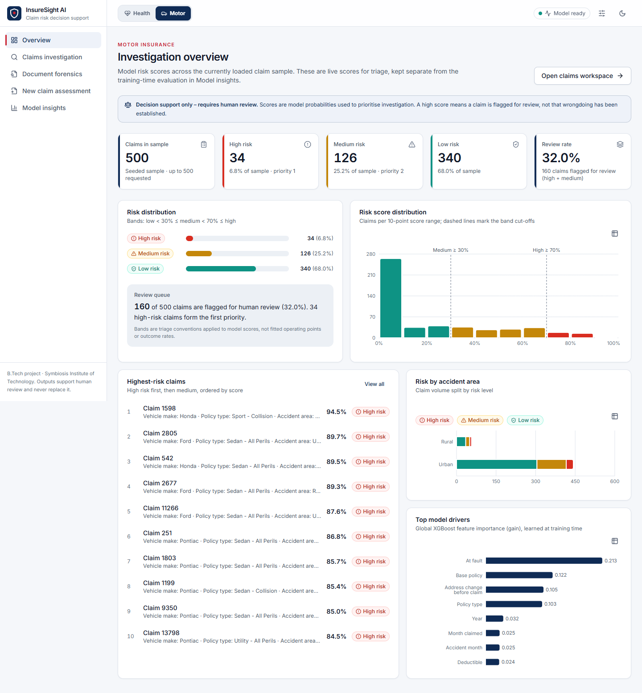
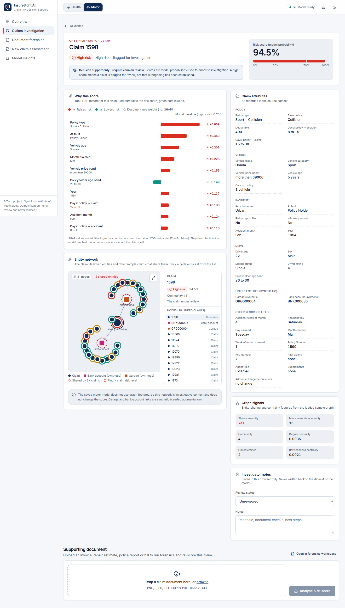
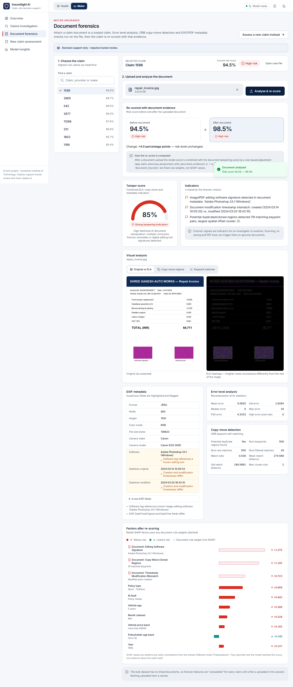
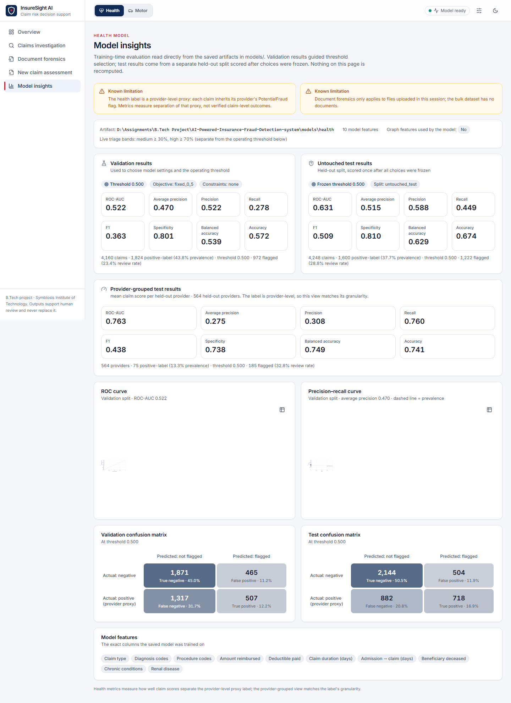

# AI-Powered Insurance Claim Fraud Detection (Health/Motor)

B.Tech project: a decision-support system that flags potentially fraudulent
health and motor insurance claims by combining **document forensics**,
**graph relationship analytics**, and an **explainable XGBoost risk score**
(SHAP), served through a Streamlit investigator UI.

This is an academic decision-support system, not an autonomous fraud
adjudication system — it never claims to have "proven" fraud. Outputs are
phrased as risk categories ("low"/"medium"/"high") and SHAP-based evidence.

Real Indian claims data was not available for this student project. The
system is built and evaluated on public Kaggle datasets adapted to represent
Indian TPA-style claims, with controlled synthetic fraud-ring relationships
added for evaluation (see [Datasets and synthetic data](#datasets-and-synthetic-data)).


## Architecture

```
data/raw/{motor,health,demographics}      src/data/
        (Kaggle CSVs, local-only)    ->   loaders, validation, preprocessing,
                                           splits, synthetic augmentation
                                                |
        +-----------------------------+--------+------------------------+
        |                             |                                 |
  src/forensics/                src/graph/                     src/data/preprocessing
  ELA, copy-move,          construction (NetworkX graph)        structured claim/policy
  metadata analysis        + features (centrality, community,   features (per domain)
  (per-document)             entity-sharing "fraud-ring"
                              indicators)
        |                             |                                 |
        +-----------------------------+--------+------------------------+
                                       |
                              src/features/fusion.py
                        (claim_key-joined structured + graph
                              + forensic feature matrix)
                                       |
                        src/models/{health,motor}.py
                          (XGBoost, class-imbalance handled
                             via scale_pos_weight)
                                       |
                    +------------------+------------------+
                    |                                     |
        src/models/evaluation.py               src/explainability/{health,motor}.py
        Accuracy/Precision/Recall/F1/ROC-AUC          SHAP per-claim explanations
                    |                                     |
                    +------------------+------------------+
                                       |
                          src/pipeline/inference.py
                    (per-claim risk assessment: probability,
                      risk category, top SHAP factors)
                                       |
                                    app/
                          (Streamlit investigator UI)
```

### Components

| Path | Responsibility | Docs |
| --- | --- | --- |
| `src/data/` | Dataset loading, schema validation, preprocessing, leakage-safe train/val/test splits, synthetic entity/fraud-ring augmentation | [Datasets and synthetic data](#datasets-and-synthetic-data), [`docs/running.md`](docs/running.md) (raw file layout) |
| `src/forensics/` | Error Level Analysis, copy-move (ORB keypoint) detection, EXIF & PDF metadata analysis on claim document images and PDFs | [`docs/forensics_ela.md`](docs/forensics_ela.md), [`docs/forensics_copy_move.md`](docs/forensics_copy_move.md), [`docs/forensics_metadata.md`](docs/forensics_metadata.md), [`docs/component_evaluation.md`](docs/component_evaluation.md) (tampering benchmark) |
| `src/graph/` | Builds a `networkx` entity graph per claim (policyholder/provider/physician/garage/bank account) and derives centrality, community, and shared-entity features; `rings.py` detects candidate fraud rings from unexpected co-sharing | [`docs/graph.md`](docs/graph.md) |
| `src/features/` | Fuses structured + graph + forensic signals into one `claim_key`-indexed feature matrix, `claim_key`-aligned so no source silently drops rows | [Architecture](#architecture) |
| `src/models/` | `HealthFraudModel`/`MotorFraudModel` (XGBoost), shared evaluation metrics, JSON-based model persistence (no `pickle`) | [Model performance](#model-performance), [`docs/review_and_audit.md`](docs/review_and_audit.md) (workload planner) |
| `src/explainability/` | SHAP `TreeExplainer`-based global/local explanations, per domain plus a shared model-agnostic layer | [What the web app shows](#what-the-web-app-shows-and-what-it-does-not) |
| `src/pipeline/` | Wires fusion + model + evaluation + SHAP into one per-claim risk assessment call | [Architecture](#architecture) |
| `app/` | InsureSight AI Streamlit investigator UI: overview KPIs, claims workspace, document forensics, and model insights | [Running the Streamlit app](#running-the-streamlit-app) |
| `scripts/train_models.py` | Offline training entry point that produces the model artifacts `app/` loads | [Training](#training) |
| `api/`, `web/` | FastAPI layer and React investigator app, including reviews, audit records and the workload planner | [Running the web app](#running-the-web-app-fastapi--react), [`docs/review_and_audit.md`](docs/review_and_audit.md) |
| `scripts/run_benchmarks.py` | Tampering and fraud-ring benchmarks (no raw data needed) | [`docs/component_evaluation.md`](docs/component_evaluation.md) |
| `tests/` | Unit + integration tests | [`docs/running.md`](docs/running.md) |

## Datasets and synthetic data

| Domain | Kaggle source | License | Target |
| --- | --- | --- | --- |
| Motor | `shivamb/vehicle-claim-fraud-detection` | CC0 | `FraudFound_P` — real, claim-level |
| Health | `rohitrox/healthcare-provider-fraud-detection-analysis` | CC0 | `PotentialFraud` — real, but **provider-level**, not claim-level (see below) |
| Demographics reference | `patelparth3399/indian-insurance-premium-prediction-dataset` | CC0 | none (used only to sample Indian-context demographic attributes) |

Expected file names and locations: [`docs/running.md`](docs/running.md#raw-data-layout).

Two known, deliberate approximations, both documented in code and never
presented as ground truth:

- **Health fraud label is provider-level.** Kaggle's health dataset only
  labels *providers* as `PotentialFraud`, not individual claims. A claim-
  level target is derived (`claim_fraud_label_provider_derived`, in
  `src/data/preprocessing.py`) and named that way everywhere in code — never
  bare `fraud` — precisely so nobody downstream mistakes it for a verified
  per-claim label.
- **Motor's graph entities are synthetic.** The raw motor dataset has no
  `GarageID`/`BankAccountID` columns at all. `src/data/synthetic.py`
  generates them (seeded, deterministic) and can inject controlled
  "fraud rings" (claims sharing a garage/bank account) so the graph-analytics
  stage has something to detect and can be validated against a known ground
  truth (`synthetic_fraud_ring_label`) — kept strictly separate from the real
  `FraudFound_P` label at every stage. See `src/data/synthetic.py` and [`docs/graph.md`](docs/graph.md).

No claim-level document → image mapping exists in any source dataset, so
forensic features default to an "unavailable" placeholder for the bulk
dataset; the Streamlit app's document-upload panel is what actually
exercises the forensics pipeline against a real image or PDF document, per
claim, live.

## Setup

```bash
python -m venv .venv
./.venv/Scripts/python.exe -m pip install -r requirements.txt -r requirements-dev.txt
```

Use `./.venv/Scripts/python.exe` for every command below (not a bare
`python`) so you're running against the project's own virtual environment.

Place the raw Kaggle CSVs under `data/raw/{motor,health,demographics}/` per
the file mapping in [`docs/running.md`](docs/running.md#raw-data-layout) — `data/` is gitignored
(generated/local-only, not committed), and every loader in `src/data/`
raises an actionable `DatasetFileMissingError` naming the exact expected
path if a file isn't there.

## Training

The Streamlit app never fits a model in-process — it only loads an artifact
already saved to disk. Produce one with:

```bash
./.venv/Scripts/python.exe scripts/train_models.py --domain both
```

This samples the raw data — by default the **full 15,420-claim motor
dataset** and a **28,000-claim health sample** (8,000 inpatient + 20,000
outpatient, out of ~558K available); see [Model performance](#model-performance)
for why these are the recommended defaults and
`models/<domain>/validation_experiment.json` for the comparison that informs
them. Both domains together train in well under two minutes on ordinary
hardware. The script builds the fused feature matrix (forensics-unavailable
+ graph + structured features), does a leakage-safe train/validation split
(row-stratified for motor, provider-grouped for health so no provider's
claims span both splits), fits an `XGBClassifier`-backed model with
`scale_pos_weight` computed from the split's own class balance, evaluates on
the held-out validation split, and saves the model
(`model.json`/`metadata.json`, XGBoost's own JSON format — no `pickle`) plus
`eval_metrics.json`/`confusion_matrix.json` into `models/<domain>/`.

Pass smaller `--*-sample-size` flags for a faster, weaker model (see
`--help` for the full list):

```bash
./.venv/Scripts/python.exe scripts/train_models.py --domain motor --motor-sample-size 5000
./.venv/Scripts/python.exe scripts/train_models.py --domain health \
    --health-inpatient-sample-size 400 --health-outpatient-sample-size 900
```

`models/` is gitignored; every teammate/grader needs to run this once
locally (or receive the artifact out-of-band) before the app can load a
model.

## Model performance

The previously listed motor ROC-AUC 0.724 and health ROC-AUC 0.883 are
historical supplied validation baselines, not current performance claims.
Those artifacts used graph features built before splitting and a fixed 0.50
threshold. The current training script creates row/provider-disjoint train,
validation, and test partitions, selects model settings and an operating
threshold from validation only, and writes untouched test results to
`models/{motor,health}/test_metrics.json`. Validation metrics, threshold
selection, curve data, and model comparisons are saved in separate sidecars.
Generated model artifacts are gitignored; rerun the training command above
to reproduce them.

Motor training compares structured features with structured plus split-local
graph features generated from synthetic garage/account links. These links are
not observed insurance data, so validation average precision selects the
representation. Health `PotentialFraud` is a provider-derived proxy inherited
by claims, not verified claim-level fraud. Claim prevalence is weighted by
provider claim volume and should not be compared directly with provider-level
prevalence.

## Component evaluation without labeled claims

The problem statement asks for each component to be evaluated without real
labeled Indian claims. The risk model is evaluated on the Kaggle labels above.
Document forensics and ring detection have no labels at all, so they are
measured on generated data where the right answer is known by construction:

```bash
./.venv/Scripts/python.exe scripts/run_benchmarks.py     # or: make benchmarks  (~4 min)
```

This writes `models/benchmarks/tampering_benchmark.json` and
`models/benchmarks/ring_benchmark.json`. The web app's Model insights page
shows both, and each claim's case file quotes the relevant row.

### Document tampering (`src/forensics/benchmark.py`)

40 rendered hospital/garage bills, each saved like a phone capture (camera EXIF,
JPEG). Every bill is scored untouched (original, gallery re-save, downscale, PNG
screenshot) and with four known edits: a line-item row cloned over another
(copy-move), the total spliced in from another bill, the total re-typed with the
camera metadata kept, and the same edit saved by an image editor. Every file is
also re-scored after a chat-app style re-share (75% size, JPEG 70, metadata
stripped). `--images-dir` runs the same edits on a folder of real bills.

| Check (as submitted) | Edited bills flagged | Untouched bills flagged | ROC-AUC |
| --- | --- | --- | --- |
| Error level analysis | 0% | 0% | – |
| Copy-move | 100% | 100% | 0.55 |
| Metadata | 25% (editor saves only) | 0% | 0.62 |
| **Combined verdict** | **100%** | **100%** | **0.64** |

**Finding: the current pixel checks do not separate edited bills from untouched
ones.** Copy-move flags every bill, because printed text repeats the same glyphs
at regular row spacing, and ORB's ratio test throws away exactly the duplicate
matches a cloned row produces. Whole-image ELA statistics do not move for an
edited area of a few percent of the page. Only the editor's Software tag is a
reliable signal, and chat-app re-sharing strips it (0% detected after
re-share). The app therefore shows document risk as a prompt to inspect the
file, with this benchmark quoted next to it, not as evidence.

### Fraud-ring recovery (`src/graph/rings.py`, `src/graph/ring_benchmark.py`)

The detector looks for *unexpected co-sharing*: a pair of entities (garage, bank
account, phone) used together by more claims than their own popularity
explains (Poisson tail test, alpha 0.001). Linked claims form candidate rings
of 3 or more. The benchmark generates 15,420-claim populations (the motor
dataset's size) with 40 rings of 3 to 12 claims (1.9% of claims), busy
legitimate garages, mostly unique accounts and phones, households sharing an
account and phone, and partial overlap (each member uses each ring entity with
probability 0.6 to 0.8). Noise is the share of recorded values reformatted or
given a one-character typo. Each row is the mean of 3 populations.

| Noise | Rings found: exact / normalised / typo-tolerant | Precision (typo-tolerant) | "Any shared entity" precision |
| --- | --- | --- | --- |
| 0% | 88% / 88% / 88% | 20% | 1.9% |
| 20% | 59% / 78% / 88% | 20% | 2.0% |
| 40% | 16% / 55% / 88% | 21% | 2.2% |

Typo-tolerant matching keeps ring recovery flat as details drift between
forms, while exact matching collapses. Precision is about 10 times the naive
rule but still low: households sharing an account and phone look like small
rings. Raising the minimum ring size trades recall for precision (size 3 / 4 / 5:
88% / 73% / 60% of rings found at 20% / 29% / 43% precision). Claim-level recall
tops out at 77%: a member who shares only one ring entity cannot be linked by a
pair test.

### How graph and document signals reach the investigator

The structured-only vs. structured-plus-graph comparison above (motor
`validation_experiment.json`) found that the synthetic graph features did not
improve validation average precision, so neither saved model uses graph or
document features. The project therefore reports them **as separate signals,
not as model inputs**: each case file shows the model risk score (which alone
sets the triage band), a *network risk* (the ring detector's verdict and
evidence for that claim) and a *document risk* (the tampering verdict for an
uploaded file), each with its own benchmark result. The document upload's
before/after re-score keeps its documented rule-based adjustment.

## Running the Streamlit app

```bash
./.venv/Scripts/python.exe -m streamlit run app/main.py
```

Requires both `data/raw/` (for the claim browser) and a trained model
artifact under `models/` (for scoring) — the app shows an actionable
`st.error` naming the missing piece and stops, rather than a raw traceback,
if either is absent.

## Running the web app (FastAPI + React)

A second front end for the same pipeline: a FastAPI layer in `api/` and a
React + Vite + TypeScript app in `web/`. The Streamlit app is unchanged and
keeps working alongside it. Like Streamlit, the API only **loads** the
trained artifacts from `models/` once at startup (it never trains) and
builds the same bounded, seeded samples (500 motor; 150 inpatient + 350
outpatient health by default, same limits as the Streamlit sliders).

**One command** (API on `:8000`, web app on `:5173`):

```bash
make dev                                                     # macOS / Linux / Git Bash
powershell -ExecutionPolicy Bypass -File scripts/dev.ps1     # Windows PowerShell
```

**Or separately:**

```bash
# 1. API (requires the trained models under models/ and data under data/raw/)
./.venv/Scripts/python.exe -m uvicorn api.main:app --reload --port 8000
#    interactive docs: http://localhost:8000/docs

# 2. Web app (Node 20+), proxies /api -> :8000
cd web
npm install
npm run dev            # http://localhost:5173
```

Production build: `cd web && npm run build && npm run preview` (serves
`dist/` on `:4173`, still proxying `/api`). Point the dev proxy at another
API with `INSURESIGHT_API_URL`, or a deployed build at one with
`VITE_API_BASE`; allow extra browser origins with
`INSURESIGHT_CORS_ORIGINS`.

### API endpoints

| Method | Path | Returns |
| --- | --- | --- |
| GET | `/health` | Model readiness per domain, feature count, risk-band cut-offs |
| GET | `/domains/{domain}/overview` | Sample KPIs: counts per risk level, review rate, score histogram, segment breakdown, global importance, top claims |
| GET | `/domains/{domain}/claims` | Paginated table; `search`, `risk`, `min_probability`, `segment`, `sort`, `order`, `page`, `page_size` |
| GET | `/domains/{domain}/claims/{claim_key}` | Attributes (grouped), graph signals, probability, risk level, top-10 SHAP factors, network risk (candidate ring + evidence) and benchmark context |
| GET | `/domains/{domain}/claims/{claim_key}/graph` | Ego network (claim, entities, claims sharing them), capped at 80 nodes |
| POST | `/domains/{domain}/claims/{claim_key}/document` | Upload image/PDF: ELA heatmap, copy-move pairs + regions, flagged metadata, tamper verdict, before/after re-score |
| GET | `/domains/{domain}/schema` | New-claim form fields, taken from the saved model's feature list |
| POST | `/domains/{domain}/assess` | Score a new claim from attributes (+ optional document) |
| GET / POST | `/domains/{domain}/claims/{claim_key}/review` | Investigator decision history / record a decision (append-only log) |
| GET | `/domains/{domain}/reviews` | Decision counts and the retraining labels they imply |
| GET / POST | `/domains/{domain}/claims/{claim_key}/audit-report` | Audit record as JSON, or `?format=html` printable; POST adds forensics for an attached document |
| GET | `/domains/{domain}/insights` | Saved metrics, curves, confusion matrices, threshold and limitations from `models/<domain>/`, the workload (gain) curve, plus `models/benchmarks/` results |

Every sample-dependent endpoint accepts `sample_size` (motor, 100–3000) or
`inpatient_sample_size` (20–1200) / `outpatient_sample_size` (40–2800).
Unknown domains and claims return `404`; invalid parameters or uploads
return `422`; a missing model or dataset returns `503` with the fix.

### What the web app shows (and what it does not)

- Every number comes from the API or a saved artifact. Nothing is recomputed,
  hard-coded or rounded beyond display formatting (full values are in tooltips).
- Scores are labelled "risk score (model probability)", and claims are
  "flagged for review"; each scored view carries a *decision support only –
  requires human review* banner.
- SHAP factors (log-odds, TreeExplainer) are shown separately from the
  **rule-based** document-evidence adjustment that
  `fuse_assessment_with_document_evidence` applies after an upload; the latter
  is marked as "not SHAP".
- Neither saved model uses graph features, so the entity network is shown as
  investigative context. Motor garage/bank-account links are synthetic, and the
  health label is a provider-level proxy; both are stated on Model insights.
- Network risk and document risk sit beside the model score on each case file,
  never merged into it, each with its benchmark result (see
  [Component evaluation](#component-evaluation-without-labeled-claims)). Network
  risk uses garage + bank account for motor and physician + beneficiary for
  health (providers are excluded because every physician belongs to one).
- Reviewers record *confirmed suspicious*, *cleared* or *needs more info* on
  each case file. Decisions go to an append-only log with the score they saw,
  and confirmed/cleared decisions are exported as training labels. Each case
  file also exports an audit record (JSON with an integrity hash, or a
  printable page) with score, band, SHAP factors, network evidence, document
  findings, model version and timestamp. Model insights has a workload planner
  ("review the top N%, reach X% of positive-label claims"). See
  [`docs/review_and_audit.md`](docs/review_and_audit.md).

| Overview | Claim case file |
| --- | --- |
|  |  |
| **Document forensics** | **Model insights** |
|  |  |

### Web checks

```bash
./.venv/Scripts/python.exe -m ruff check api tests/test_api.py
cd web && npm run lint && npm run typecheck && npm run check:contrast && npm run build
```

## Demo workflow

1. Install dependencies and place the raw datasets (Setup, above).
2. `./.venv/Scripts/python.exe scripts/train_models.py --domain both` — trains
   and saves both models (a few minutes; prints validation metrics per
   domain as it goes). Then `./.venv/Scripts/python.exe scripts/run_benchmarks.py`
   for the forensics and ring-detection benchmarks (no raw data needed).
3. `./.venv/Scripts/python.exe -m streamlit run app/main.py` — opens InsureSight AI.
4. Use the sidebar to pick a domain (Health / Motor) and a workspace:
   **Overview**, **Claims Investigation**, **Document Forensics**, or
   **Model Insights**. Adjust the sample-size sliders if wanted.
5. Overview shows model-scored KPIs for the *currently loaded sample*
   (not precomputed dataset labels). Claims Investigation is a searchable
   table; inspect one claim for attributes, graph signals, probability,
   risk category, and claim-specific SHAP factors.
6. Document Forensics reuses the existing ELA / copy-move / metadata
   pipeline: attach a file to a loaded claim (re-fuse + re-score) or run a
   new-claim document assessment with investigator-supplied attributes.
7. Model Insights shows the training-time `eval_metrics.json` /
   `confusion_matrix.json` sidecars for the selected domain only.

## Testing

```bash
./.venv/Scripts/python.exe -m pytest tests/ -q
```

Test layout, every command and the environment variables: [`docs/running.md`](docs/running.md).
CI (`.github/workflows/ci.yml`) runs the full suite on every push/PR against
synthetic in-memory fixtures only — it does not require `data/raw/`.

## Limitations

- **Provider-level health label, not claim-level** — see
  [Datasets and synthetic data](#datasets-and-synthetic-data) above.
  `claim_fraud_label_provider_derived` is a documented approximation.
- **Synthetic graph entities for motor** — `GarageID`/`BankAccountID` and any
  injected fraud rings are synthetic, generated to exercise and validate the
  graph-analytics stage, not observed real-world relationships.
- **No real claim-document mapping** — forensic features are "unavailable"
  by default for the bulk dataset; only a claim scored through the app's
  upload panel gets a real forensic signal.
- **Interactive app sample size, still bounded** — the *Streamlit app*
  builds features over a bounded, seeded sample of the raw data (500 motor /
  150+350 health claims by default, adjustable via the sidebar sliders), not
  the full 15,420 motor / ~558k health claims, so claim-selection stays
  responsive in an interactive session. Training is a separate, offline step
  and is no longer similarly bounded — `scripts/train_models.py`'s defaults
  now use the full motor dataset and a 28,000-claim health sample (see
  [Model performance](#model-performance)), since `src/graph/features.py`'s
  centrality now auto-switches to an approximate/cached computation above
  1,500 graph nodes (see [`docs/graph.md`](docs/graph.md)) and both domains train in well
  under two minutes combined. The app's own sample-size defaults were left
  unchanged regardless — interactive responsiveness, not centrality cost, is
  what motivates that bound (see `app/config.py`).
- **Graph signals are evidence, not verdicts** — a claim is never labeled
  fraudulent for having high centrality, a shared entity or a candidate ring.
  Neither saved model uses graph features; network risk is shown beside the
  score for an investigator to weigh.
- **Document forensics do not yet work on bills** — on the tampering benchmark
  the combined verdict flags every untouched bill as well as every edited one
  (see [Component evaluation](#component-evaluation-without-labeled-claims)).
  A text-level check (OCR the amounts and verify the arithmetic, duplicate bill
  numbers) is the likely next step.
- **Ring detection is measured on generated rings only** — and households
  sharing an account and phone are its main source of false alarms.
- **SHAP explains the model, not fraud** — SHAP attributions describe what
  drove *this model's* prediction, not proof that the claim is fraudulent.
- **Single-process local demo** — no authentication or multi-user session
  isolation; this is an academic decision-support demo, not a production
  service.

## Status

Full stack implemented end-to-end: data ingestion → forensics → graph
analytics → feature fusion → XGBoost models → evaluation → SHAP
explainability → inference pipeline → model persistence → Streamlit UI, with
real trained artifacts producible via `scripts/train_models.py`. Model metrics,
curves and confusion matrices are in `models/<domain>/` and on the web app's Model
insights page; component benchmarks are in
[`docs/component_evaluation.md`](docs/component_evaluation.md), and the review/audit
workflow in [`docs/review_and_audit.md`](docs/review_and_audit.md).
